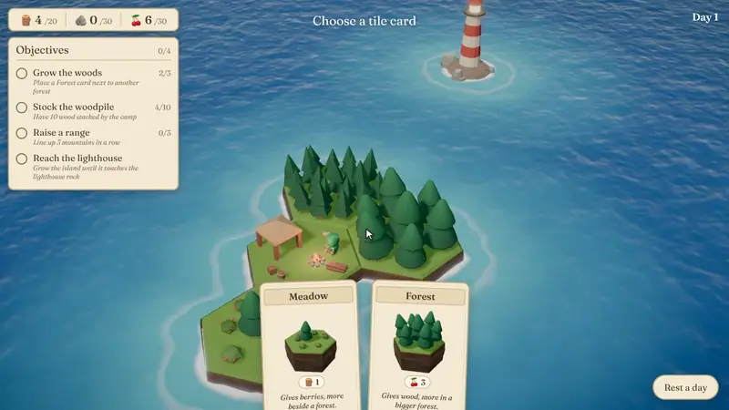
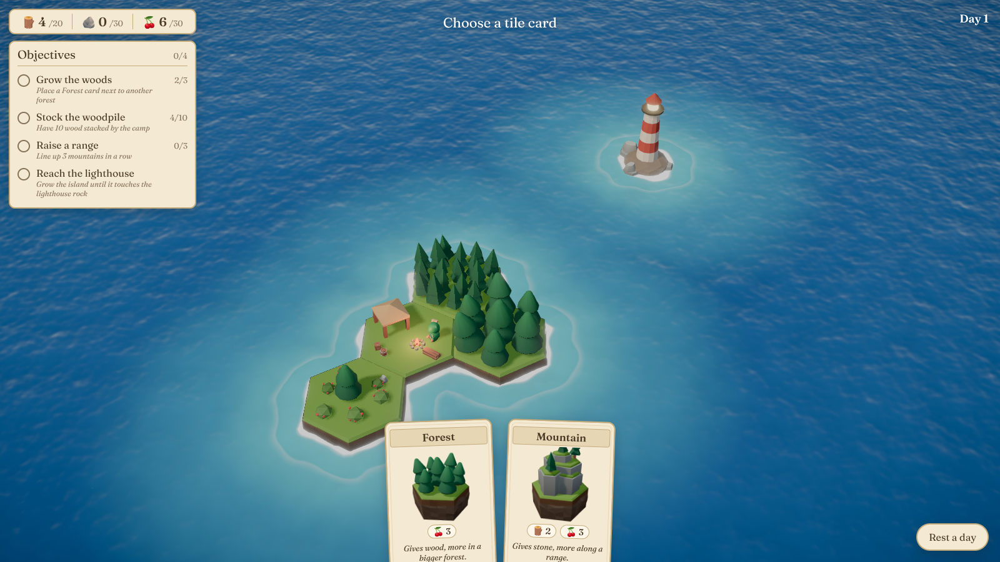
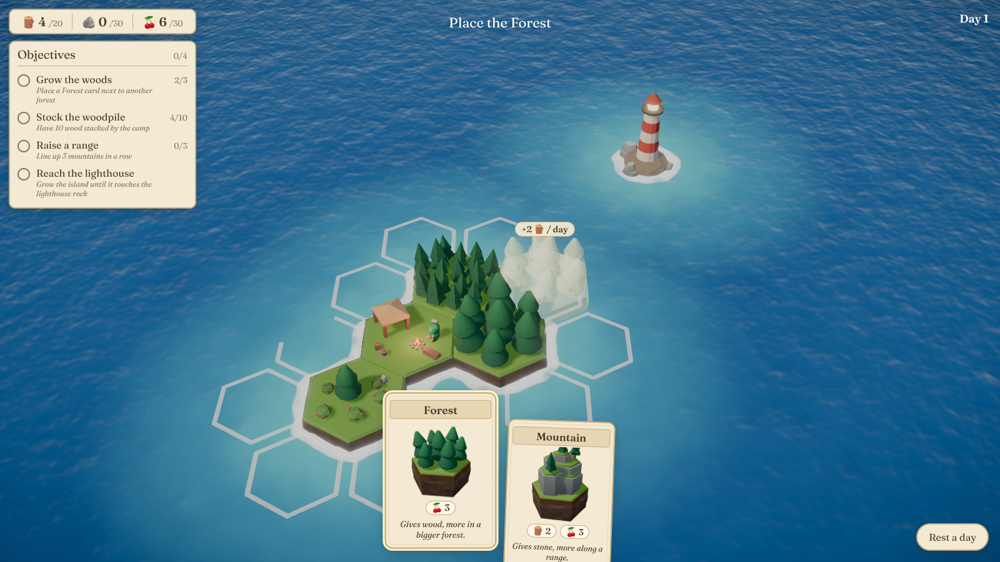
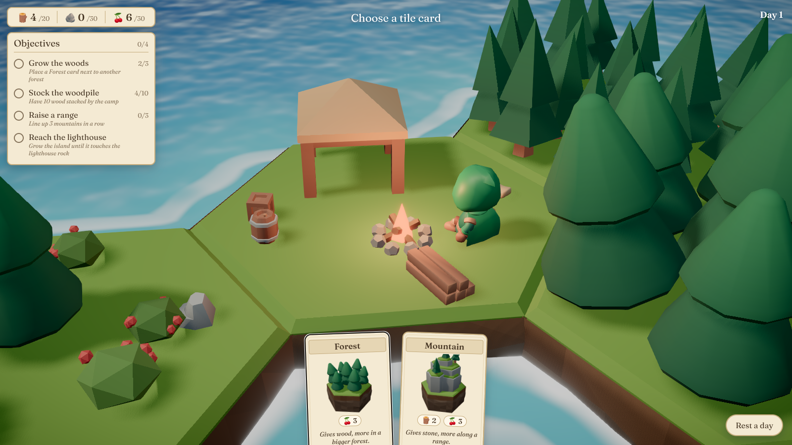
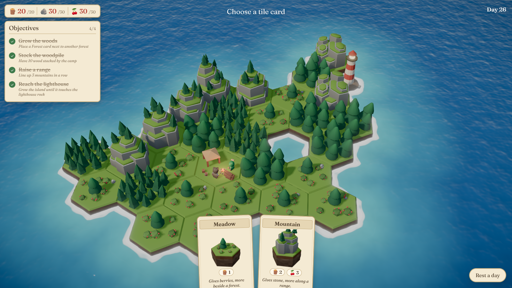

# Castaway Isle

**A quick test of how well Claude Opus can make a game.**

A cozy hex-tile island builder: draft tile cards, grow your island one hex at a time,
and reach the lighthouse so a second castaway can join you.



▶️ **[Watch the full demo video (MP4)](docs/media/demo.mp4)**

## Inspiration and credit 💛

This project exists because of a lovely post by
**[@hakimieiqbal](https://x.com/hakimieiqbal)** on X, showing a cozy island game
they are building one hex at a time with Claude Opus. In their game you start as a
single castaway on a tiny island, place hex tiles to expand it, gather resources and
complete objectives, and reaching the lighthouse brings another castaway to the island.
It already looks like a polished indie game, and it's well worth following
their progress.

All credit for the idea and the game design goes to them. Their prompts and code
weren't shared, so this repo is not their game and isn't affiliated with them. It's an
independent, from-scratch experiment to see how far Claude Opus can get on a game like
that, starting only from the public post. If you enjoy this, please go and support
the original. 🙏

## The main idea

This was a fast experiment, done in a single Claude Code session:

1. **Read the post.** Start from the post's description and a screenshot from its video.
2. **Study the game.** From the screenshot, work out the mechanics:
   - choosing between two tile cards, each with a resource cost
   - adjacency bonuses ("more in a bigger forest", "more along a range")
   - resource storage caps
   - a tutorial chain of objectives
   - a lighthouse visible from the start as the long-term goal

   Then list the visual ingredients: thick hex tiles with rocky sides, stylized water
   with shoreline foam, warm lighting, and a parchment-style UI.
3. **Get real assets.** The key lesson: code alone gives you "programmer art".
   A good-looking game needs proper 3D models, so the next step was to download
   free asset packs (see below).
4. **Build the prototype** with Three.js, TypeScript and Vite. The code adds what the
   packs don't have:
   - a custom water shader
   - a palette regrade
   - rocky cliff sides on every tile
   - a campfire, berry bushes and the lighthouse
5. **Check the result in a browser.** A headless browser took screenshots after each
   step, and the visuals were tuned from them.

## Screenshots

| | |
|---|---|
|  |  |
| The starting island, the lighthouse on the horizon, and your first two cards. | Placing a tile shows a preview and how much it will produce each day. |
|  |  |
| Close-up of the camp: the castaway, the campfire and the woodpile. | The island after about four weeks of play, now joined to the lighthouse. |

## Free assets, free for commercial use ✅

All 3D models come from **[KayKit](https://kaylousberg.itch.io)** by
**[Kay Lousberg](https://www.kaylousberg.com)**. They're released under
**CC0 1.0 (public domain)**: free for personal **and commercial** use, and you
can modify and redistribute them. Credit isn't required, but Kay deserves a big thank you.

| Asset pack | Used for | License |
|---|---|---|
| [KayKit Medieval Hexagon Pack](https://kaylousberg.itch.io/kaykit-medieval-hexagon) | Hex tiles, trees, mountains, rocks, props | CC0 1.0, see [`LICENSE.txt`](assets/kaykit-medieval-hexagon/LICENSE.txt) |
| [KayKit Adventurers Character Pack](https://kaylousberg.itch.io/kaykit-adventurers) | The castaways (rigged and animated) | CC0 1.0, see [`LICENSE.txt`](assets/kaykit-adventurers/LICENSE.txt) |

The libraries and font are also free for commercial use:

| Library / font | License |
|---|---|
| [three.js](https://threejs.org) | MIT |
| [postprocessing](https://github.com/pmndrs/postprocessing) | Zlib |
| [Fraunces](https://fonts.google.com/specimen/Fraunces) (via Fontsource) | SIL Open Font License 1.1 |
| [Vite](https://vite.dev) / [TypeScript](https://www.typescriptlang.org) | MIT / Apache-2.0 |

These parts are original to this project:
- the campfire, berry bushes and lighthouse
- the cliff sides, the water shader and the UI
- the card art, which is rendered in-engine from the tile models

## Run it

```sh
npm install
npm run dev      # then open http://localhost:5173
npm run build    # typecheck + production build into dist/
```

## How to play

- **Choose a tile card.** You're dealt two cards each day. Click one, or press `1` / `2`.
- **Place it.** Valid spots glow on the water. Hovering shows a preview and what the tile
  would produce per day. Click to place; `Esc` or clicking the card again cancels.
- **The day ends** after each placement: every tile produces resources, then you get a new hand.
- **Rest a day** when you can't afford anything: the island still produces and you redraw.
- **Camera:** left-drag to orbit, right-drag to pan, scroll to zoom.

| Card | Cost | Produces each day |
|---|---|---|
| Meadow | 1 🪵 | 🍒 1, +1 per neighbouring forest (max +2) |
| Forest | 3 🍒 | 🪵 1, +1 for every 3 tiles in its connected forest |
| Mountain | 2 🪵 3 🍒 | 🪨 equal to the longest straight mountain range through it (max 4) |

All the numbers live in `src/game/config.ts` and `src/game/cards.ts`.

## Project layout

```
src/
  game/        pure game logic, no rendering
    hex.ts       axial hex coordinates (pointy-top, matches the KayKit tiles)
    config.ts    tunable numbers: caps, starting resources, lighthouse position
    cards.ts     card definitions and yield rules (cluster size, range length)
    state.ts     game state, day loop, objectives
  render/      everything Three.js
    world.ts     scene, camera, lights, post-processing, placement feedback
    water.ts     stylized water shader + distance-to-shore field for foam and shallows
    tiles.ts     tile visuals and the rocky cliff skirt around each tile
    props.ts     procedural props the packs lack: campfire, berry bushes, lighthouse
    assets.ts    model loading and the palette regrade of the KayKit texture
    cardArt.ts   card illustrations rendered from the real tile models
    tween.ts     tiny tween runner and seeded RNG
  ui/hud.ts    DOM overlay: resources, objectives, cards, floating labels
assets/        the CC0 model packs, served as static files
docs/          screenshots and the demo video
```

## Honest status

This is an early prototype from a quick test, not a finished game.

- **The economy is too generous.** Resources hit their caps quickly, so the choices don't
  feel tight yet. Balancing is the next job.
- **Castaways don't walk around or work tiles yet.** Planned: walking to tiles, and
  actions like "Cut tree" and "Mine rock".
- **It's less painterly than the original.** That needs more polish: grass detail,
  sound and weather.

Thanks again to [@hakimieiqbal](https://x.com/hakimieiqbal) for the inspiration, and to
[Kay Lousberg](https://www.kaylousberg.com) for the wonderful free assets. 🏝️
